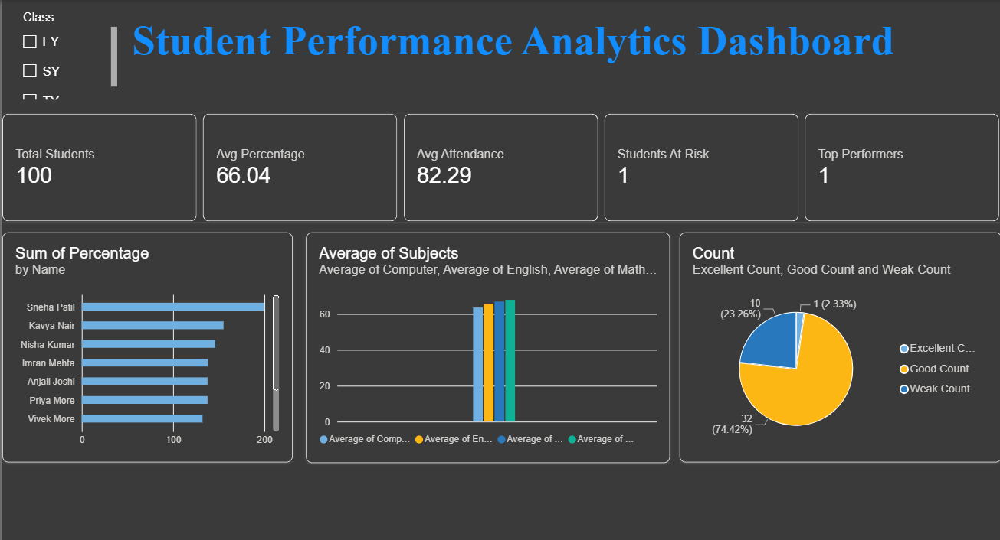
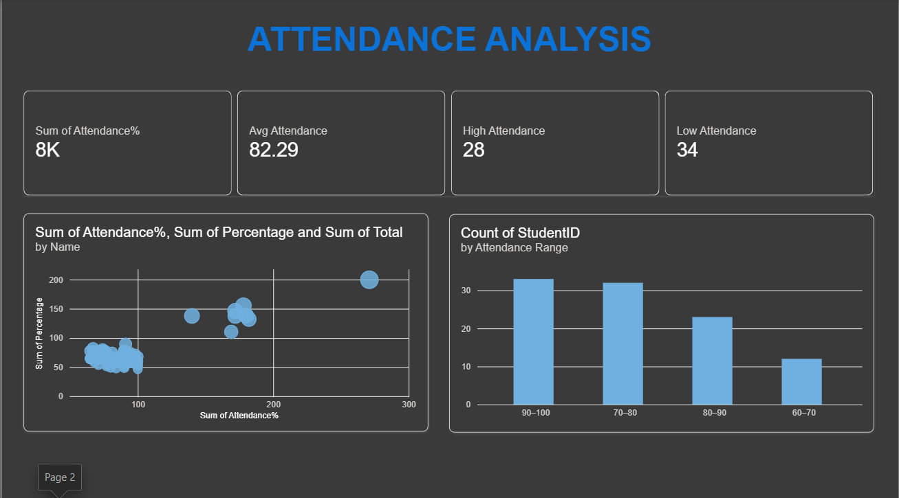
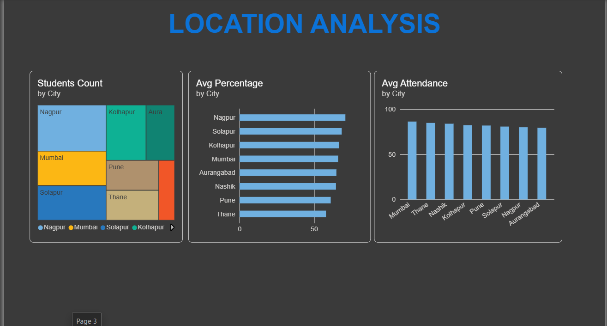
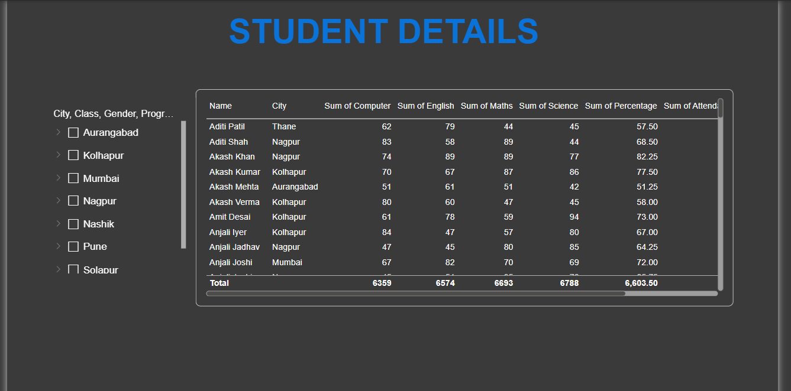
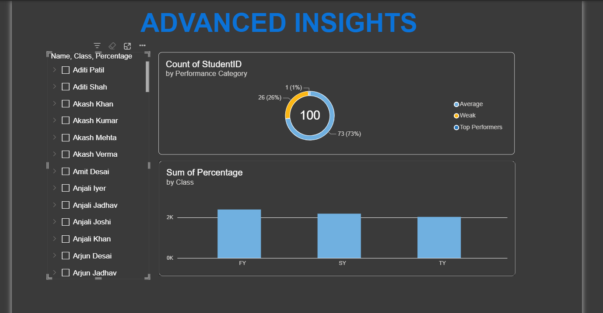
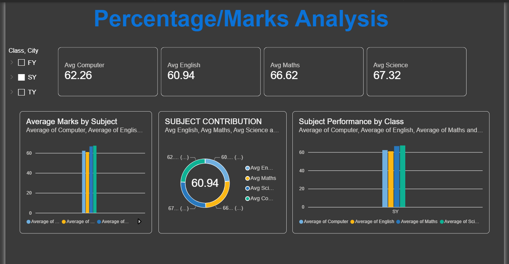

# Student Performance Analytics Dashboard | Power BI

An interactive business intelligence project built with Microsoft Power BI to explore student academic performance, attendance patterns, location-based distribution, and subject-wise marks.

## Project Overview

This project presents student data through six analytical dashboard pages, helping users explore academic performance, compare attendance, identify performance patterns, and review individual student records.

## Dashboard Previews

### 1. Student Performance Analytics

### 2. Attendance Analysis

### 3. Location Analysis

### 4. Student Details

### 5. Advanced Insights

### 6. Percentage / Marks Analysis

## Tools and Technologies

- Microsoft Power BI Desktop
- Power Query for data preparation, if used
- DAX for calculated measures, if used
- Data modeling and interactive visualization

## Skills Demonstrated

- Exploratory data analysis
- KPI reporting and dashboard design
- Academic performance analysis
- Comparative data visualization
- Presenting data for informed decision-making

## Project Files

- **Power BI report:** `Student_Performance_Analytics.pbix`
- **Screenshots:** `screenshots/`

Open the Power BI report in Microsoft Power BI Desktop to explore the report pages and available interactions.

## Key Findings

Use this section to document two or three findings verified from your dashboard, such as differences in average marks by subject, attendance and performance patterns, or location-wise comparisons.

---

*Note: Dashboard access depends on having the report file and any required data sources. Screenshots are provided for convenient preview.*
